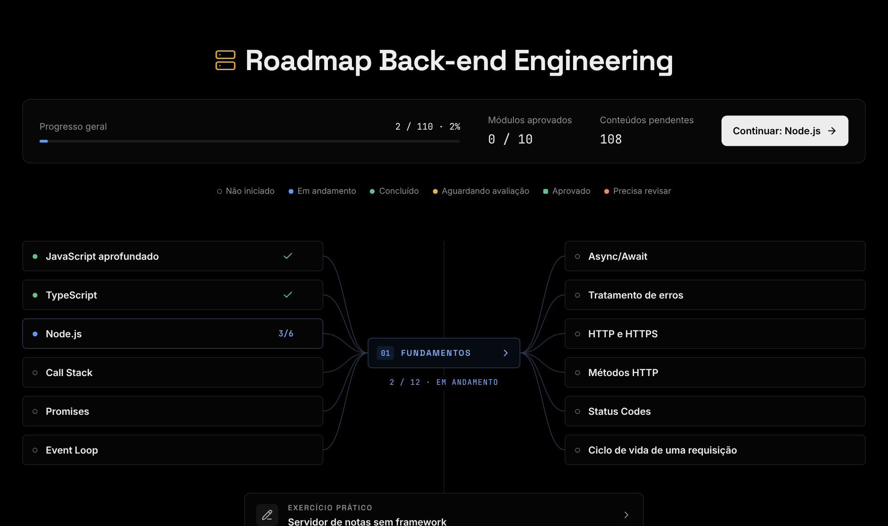
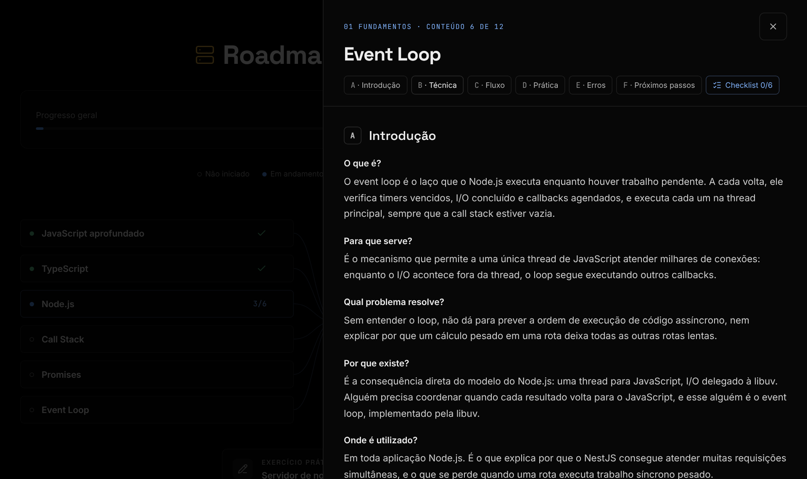

# Roadmap Back-end Engineering

Uma trilha de estudos de Back-end com **JavaScript, TypeScript, Node.js e NestJS**, organizada
como um mapa visual. Cada conteúdo tem uma aula completa, com código que roda de verdade,
exercícios práticos, checklist de aprendizagem e uma avaliação técnica por módulo.

O objetivo é aprender a **pensar como Back-end Engineer**: entender por que cada coisa existe,
que problema resolve e como funciona por dentro, e não só acumular tecnologias.



## O que tem em cada aula

| Seção | Conteúdo |
|---|---|
| A · Introdução | O que é, para que serve, que problema resolve, por que existe e onde é usado |
| B · Explicação técnica | Funcionamento interno, conceitos e exemplos explicados linha por linha |
| C · Fluxo | Diagrama em etapas do que acontece por baixo |
| D · Exemplo prático | Projeto pequeno e executável, com testes para o Thunder Client |
| E · Erros comuns | Mensagens reais, causa e correção |
| F · Próximos passos | O que estudar antes, agora e depois, e a documentação oficial |



## Conteúdo

| Módulo | Situação |
|---|---|
| 01 · Fundamentos de programação Back-end | ✅ 12 aulas, exercício e avaliação |
| 02 · NestJS e arquitetura inicial | ✅ 11 aulas, exercício e avaliação |
| 03 · DTOs e validação | Em preparação |
| 04 · APIs REST e CRUD (projeto integrado) | Em preparação |
| 05 · Banco de dados | Em preparação |
| 06 · Prisma ORM | Em preparação |
| 07 · Autenticação e segurança | Em preparação |
| 08 · Testes automatizados | Em preparação |
| 09 · Arquitetura de software | Em preparação |
| 10 · Infraestrutura e produção | Em preparação |

Todo o código das aulas foi executado antes de ser publicado. As aulas de NestJS usam a
versão 12 (projeto ESM, testes com Vitest).

## Como usar

Requisitos: **Node.js 20.19+ ou 22.12+** (testado com a linha 24).

```bash
git clone https://github.com/Brenogfr/RoadMap.git
cd RoadMap
npm install
npm run dev
```

Abra o endereço mostrado no terminal (normalmente http://localhost:5173).

### Como funciona o progresso

- Cada conteúdo tem um checklist de 6 itens; ele só conta como concluído com os 6 marcados.
- A avaliação de um módulo libera quando todos os conteúdos estão concluídos e o módulo
  anterior foi aprovado (nota mínima de 70%). Módulos futuros podem ser lidos à vontade.
- As avaliações são corrigidas sem IA, em três passos: questões de escolha automáticas; nas
  abertas, você compara sua resposta com a esperada e confirma cada critério atendido.
- O progresso fica **só no seu navegador** (não há servidor nem banco de dados). Use
  "Exportar progresso", no fim da página, para guardar um backup.

## Para desenvolvedores

| Comando | O que faz |
|---|---|
| `npm run dev` | Servidor de desenvolvimento |
| `npm run build` | Verificação de tipos e build de produção |
| `npm run preview` | Serve o build localmente |
| `npm run lint` | Lint com oxlint |
| `npm test` | Testes (Vitest): regras de progresso, correção e validação do conteúdo |

Stack: React, TypeScript, Tailwind CSS e lucide-react, sem outras dependências de execução.
Aulas e avaliações são carregadas sob demanda, para a página continuar leve.

```
src/
├── data/          conteúdo: m01/, m02/ (uma aula por arquivo) e modules/outline.ts
├── types/         formato das aulas, avaliações e do progresso salvo
├── lib/           regras de progresso e de correção (funções puras)
├── hooks/         progresso no LocalStorage e carregamento sob demanda
└── components/    roadmap, painel de estudo e avaliações
```

Para corrigir ou adicionar uma aula, edite apenas `src/data/`. O formato e a forma de
verificar estão descritos em [.claude/skills/conteudo-de-estudo](.claude/skills/conteudo-de-estudo/SKILL.md).
Detalhes da construção e dos testes estão em [docs/ENTREGA.md](docs/ENTREGA.md).

## Contribuições

Encontrou um erro em uma aula, um link quebrado ou uma explicação confusa?
Abra uma [issue](https://github.com/Brenogfr/RoadMap/issues) indicando o módulo, a aula e a seção.

## Licença

- **Código** da aplicação: [MIT](LICENSE).
- **Conteúdo** (aulas, avaliações, exercícios e documentação): [CC BY 4.0](LICENSE-CONTEUDO.md).
  Você pode compartilhar e adaptar, desde que dê o crédito.
